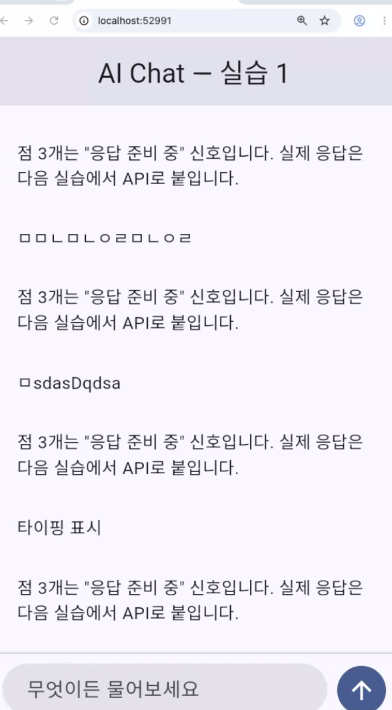

# 11주차 과제 — 실습 1 · 실습 4

GAI3008-01 응용모바일프로그래밍 11주차 과제입니다.

- 실습 1: 채팅 UI
- 실습 4: 오류와 재시도

## 실행

```bash
flutter pub get
flutter run -d chrome
```

별도 서버는 필요하지 않습니다. 이번 제출본은 실제 API 대신 로컬 가짜 응답으로 UI와 오류 흐름을 확인할 수 있게 만들었습니다.

## 실습 1 — 채팅 UI

- ✅ `ListView.builder` + `reverse: true`
- ✅ 사용자 오른쪽 / AI 왼쪽 말풍선
- ✅ `TextField` + 전송 버튼
- ✅ 빈 상태 `무엇이든 물어보세요`
- ✅ `SafeArea` + `resizeToAvoidBottomInset`로 키보드 대응

## 실습 4 — 오류와 재시도

수업 자료의 완료 기준에 맞춰 다음을 구현했습니다.

- ✅ 401 / 429 / 500 / timeout을 하나의 오류 상태로 처리
- ✅ 오류 말풍선 표시
- ✅ `다시 시도` 버튼
- ✅ 마지막 사용자 메시지 재시도
- ✅ `AnimatedSwitcher`로 오류 상태 전환
- ✅ 429 오류에서 1초 → 2초 백오프
- ✅ 오류가 난 뒤에도 새 메시지 입력 가능

### 오류 테스트 방법

입력창에 아래 문자열을 입력하면 오류를 재현할 수 있습니다.

| 입력 | 동작 |
|---|---|
| `401` | `키/권한을 확인해 주세요` — 계속 오류 |
| `429` | 두 번 오류 후 성공 — 재시도 대기 1초 → 2초 |
| `500` | 첫 요청 오류, 재시도하면 성공 |
| `timeout` | 첫 요청 오류, 재시도하면 성공 |
| 그 외 | 정상 가짜 AI 응답 |

## 실행 화면



> 실제 API 연결은 이번 제출 범위에 포함하지 않았습니다. 실습 동작을 확인하기 위해 로컬 가짜 응답과 오류 트리거를 사용했습니다.

## 테스트

```bash
flutter test
```

테스트 내용:

1. 빈 상태와 입력창 표시
2. 사용자 메시지 전송
3. 500 오류 발생 후 `다시 시도` 표시

## 단계별 커밋 예시

1. `feat: complete chat bubbles and input`
2. `feat: add empty state and keyboard handling`
3. `feat: add error state and retry flow`
4. `docs: add assignment README and screenshot`

---

GAI3008-01 · 11주차
